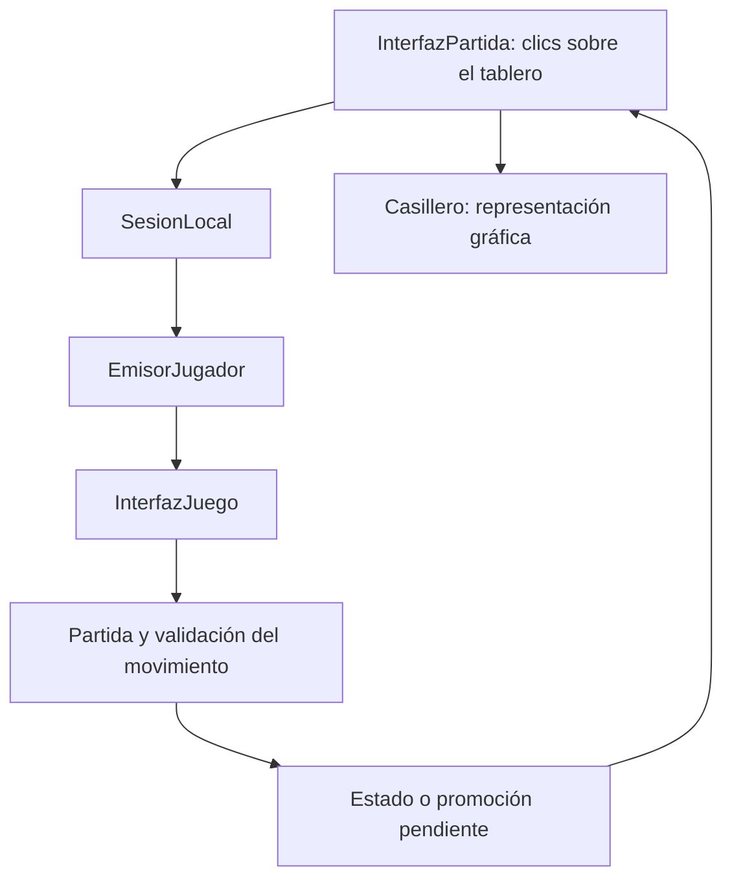

# Arquitectura de Ajedrez local

El programa separa las reglas del juego, la política de la sesión y la
representación gráfica. El modelo y las sesiones pueden utilizarse sin Tkinter;
las demostraciones de consola y las pruebas aprovechan esa separación.

## Responsabilidades

| Capa | Objetos principales | Responsabilidad |
| --- | --- | --- |
| Construcción de la aplicación | `AplicacionAjedrez` | Crea o recibe la ventana, carga el tema y prepara la partida local y sus controles. |
| Interacción gráfica | `InterfazPartida`, `PanelAnalisis` | Traducen los eventos en solicitudes, muestran estados y coordinan selección, promoción, navegación y análisis. |
| Sesión | `Sesion`, `SesionLocal`, `SesionAnalisis` | Exponen la partida y las acciones disponibles; determinan los colores controlados y seleccionables. |
| Juego local | `EmisorJugador`, `InterfazJuego`, `AutenticadorJugadores` | Identifican al emisor, comprueban el turno y administran las solicitudes de la partida local. |
| Modelo | `Partida`, `Jugada`, `EstadoPosicion`, `Tablero`, piezas | Validan y aplican movimientos, conservan estados e historial y determinan el resultado. |
| Persistencia | Funciones de `persistencia.py` | Convierten partidas a datos versionados, las reconstruyen mediante el modelo y leen o escriben archivos JSON. |
| Dibujo y preferencias | `Casillero`, `CasillaVisual`, `TemaGrafico`, `OpcionesVisuales` | Mantienen los elementos del Canvas, recursos, capas y preferencias visuales. |

`InterfazJuego` no es una ventana: forma parte del flujo de solicitudes de una
sesión local. `InterfazPartida` es la clase que maneja los eventos de Tkinter.

## Recorrido de una jugada local

1. La interfaz convierte las coordenadas del ratón en `(fila, columna)` y
   mantiene la selección de origen.
2. La sesión dirige la solicitud al emisor del color correspondiente.
   `InterfazJuego` comprueba la autorización, el turno y la situación de la partida.
3. `Partida.procesar_solicitud` construye y valida la jugada. Un rechazo no
   modifica la posición vigente.
4. Un movimiento aceptado actualiza el modelo, salvo que necesite completar una
   promoción. La interfaz consulta el resultado y representa sus consecuencias.

Una solicitud puede devolver `None` tanto si se ha aceptado como si espera una
promoción. Para distinguirlo hay que consultar `jugada_pendiente` y el estado de
la sesión; no basta con interpretar ese retorno como un movimiento consumado.

En la promoción, la elección pasa como `PiezaPromocion` a la sesión. Después de
confirmarla se actualizan el historial, el resultado y el tablero gráfico.

## Estado vigente, historial y análisis

- **`Sesion.estado_actual`** obtiene el estado de la última jugada, o el estado
  inicial si aún no hay ninguna. Es una propiedad calculada, no otra copia del tablero.
- **`InterfazPartida.estado_mostrado`** referencia la posición que se está viendo.
  Navegar por el historial cambia esa referencia y su representación, sin deshacer
  jugadas de la partida original.
- **`EstadoPosicion`** conserva la posición y los datos asociados al movimiento
  y al estado anterior. `Partida` ofrece consultas para recorrer su historial.

`AnalisisPartida` administra la continuación hipotética del tablero principal.
El botón «Siguiente» prefiere una continuación real; al volver a ella, descarta
la hipótesis provisional. Si no hay continuación real, puede seguir la hipotética.

`SesionAnalisis` crea una partida propia a partir de una copia de la posición y
sus piezas. Conserva los metadatos iniciales necesarios, pero no incorpora el
historial anterior a esa raíz. El recuento de repeticiones usa el historial de
la nueva partida, no el de la partida original.

El panel separado dispone de tablero y sesión propios. `EditorPosicion` mantiene
un borrador y construye un estado para iniciar otro análisis. Editar o jugar en
él no modifica las piezas, turnos ni resultado de la partida original.

El cierre de la partida local y la exploración de posiciones siguen políticas
distintas. El rechazo de movimientos tras finalizar se aplica en `InterfazJuego`;
no debe trasladarse indiscriminadamente a `Partida.procesar_solicitud`, que también
se utiliza desde el análisis.

## Datos que conviene distinguir

| Dato | Significado |
| --- | --- |
| `(fila, columna)` | Posición lógica: `a1 = (0, 0)`; las blancas avanzan hacia filas mayores. |
| Coordenadas del Canvas | Posición en píxeles; el eje vertical crece hacia abajo. La conversión pertenece a la capa gráfica. |
| Identificador de dibujo | Identifica un elemento del Canvas mientras existe. No es la identidad persistente de una pieza. |
| `ha_movido` | Dato de la pieza utilizado por reglas como el enroque. Los estados históricos deben conservar su propio valor. |
| Clave de repetición | Combina distribución, turno, derechos de enroque y captura al paso legalmente disponible. |
| Contador de medios movimientos | Permite evaluar las reglas de cincuenta y setenta y cinco movimientos; se reinicia con peones y capturas. |

Consultar si un movimiento anunciado permite reclamar tablas utiliza una jugada
provisional. La consulta debe conservar el tablero, el turno, el contador y el
historial de la partida que se está jugando.

## Puntos de ampliación

- **Modalidades:** implementar el contrato de `Sesion`, sus colores y sus
  capacidades. La GUI utiliza esas consultas para decidir qué controles ofrecer.
  La construcción actual en `AplicacionAjedrez` selecciona una sesión local;
  un futuro menú tendrá que coordinar la creación de otras modalidades.
- **Temas:** aportar los recursos y datos de estilo que consume `TemaGrafico`,
  y las preferencias de comportamiento de `OpcionesVisuales`. El menú para
  modificarlos todavía no está implementado.
- **Persistencia:** `partida_a_datos` y `partida_desde_datos` separan el formato
  del acceso a archivos. Un futuro almacenamiento en base de datos puede reutilizar
  esa conversión. `SesionLocal` e `InterfazJuego` admiten una `Partida` ya reconstruida
  mediante el parámetro nominal opcional `partida`; no se reemplazan atributos internos.
  La capacidad `admite_guardado_local` decide si la aplicación puede guardar esa sesión.
  Consulta el [formato y su alcance](persistencia.md).
- **IA y red:** añadir los componentes que producen o transportan solicitudes,
  junto con su coordinación con el bucle de eventos. La base actual separa
  responsabilidades, pero aún no implementa ese trabajo asíncrono.

La separación permite reutilizar componentes. No constituye una garantía de que
cualquier extensión futura pueda añadirse sin adaptar ningún contrato existente.

## Dónde comprobar estas decisiones

- [Pruebas de sesiones](../pruebas/test_sesion.py).
- [Aislamiento del análisis](../pruebas/test_analisis_partida.py).
- [Panel de análisis y edición](../pruebas/test_panel_analisis.py).
- [Posiciones iniciales](../pruebas/test_partida_estado_inicial.py).
- [Reclamación con movimiento anunciado](../pruebas/test_movimiento_anunciado.py).
- [Arranque de la aplicación](../pruebas/test_aplicacion.py).
- [Comprobador de instalación](../herramientas/comprobar_instalacion.py).

El [README](../readme.md) recoge los comandos, las reglas implementadas y las
limitaciones conocidas. La documentación de arquitectura describe el diseño
actual; no sustituye esas comprobaciones.
