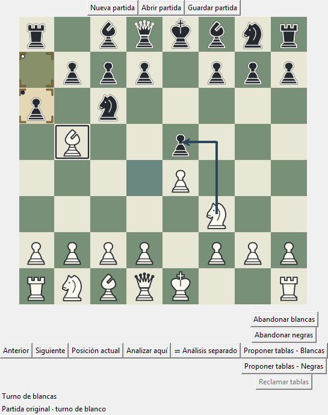

# Ajedrez local

Aplicación de ajedrez en Python y Tkinter, con partidas entre dos personas en el
mismo equipo y herramientas para explorar posiciones y variantes sin alterar la
partida original.

**Versión 0.2.0 · Guardado y recuperación de partidas locales.** Incluye archivos
JSON con el historial, el turno y el resultado. El juego contra IA, las partidas
remotas y la base de datos de usuarios todavía no están disponibles.

[Descargar v0.2.0](https://github.com/jcastb321123-ui/ajedrez-local/releases/tag/v0.2.0)
· [Pruebas automáticas](https://github.com/jcastb321123-ui/ajedrez-local/actions/workflows/pruebas.yml)



Captura de v0.2.0: partida local con una flecha de análisis y una pieza
seleccionada. Las anotaciones no modifican la posición del modelo.

## Para conocer el proyecto

- [Instalación y ejecución](#instalación): prepara una partida local.
- [Arquitectura](docs/arquitectura.md): responsabilidades, flujo de una jugada y puntos de ampliación.
- [Contribución](CONTRIBUTING.md): entorno de desarrollo, pruebas y criterios para los cambios.
- [Limitaciones actuales](#limitaciones-y-próximos-pasos): alcance real de esta versión.

## Funcionalidades disponibles

- Partida local con validación de movimientos y alternancia de turnos.
- Guardado y recuperación de partidas locales en archivos JSON, con historial,
  turno, resultado y metadatos para los movimientos especiales y las tablas.
- Capturas, enroque, captura al paso y selector gráfico de promoción.
- Abandono y propuestas de tablas por acuerdo, con controles para ambos jugadores.
  El abandono termina en tablas cuando se detecta que el adversario carece
  de material para dar mate, teniendo en cuenta las piezas de ambos bandos.
- Reclamación de tablas por triple repetición o cincuenta movimientos, también
  mediante un movimiento anunciado; tablas automáticas por cinco apariciones
  de una posición o setenta y cinco movimientos.
- Tablas automáticas por material insuficiente: sólo reyes, un alfil o caballo
  contra rey, o únicamente alfiles sobre casillas del mismo color además de los reyes.
- Evaluación del resultado desde la posición inicial: mate, ahogado, material
  insuficiente y límite de setenta y cinco movimientos si el contador recibido
  ya lo alcanza. No es necesario efectuar una jugada para reconocerlos.
- Tablas automáticas por bloqueos permanentes: las piezas distintas de los
  reyes están inmóviles y ningún rey puede alcanzar una captura que abra paso.
  Incluye barreras cerradas de peones y piezas encerradas por ellas.
- Resaltados de selección, último movimiento y jaque.
- Navegación por posiciones sin modificar el historial de la partida.
- Flechas y resaltados estratégicos, con selección y borrado de anotaciones.
- Análisis hipotético en el tablero principal o en un panel independiente.
- Editor de posiciones en el panel de análisis: colocar, quitar y mover piezas,
  elegir el turno y configurar derechos de enroque y captura al paso.
- Recursos gráficos incluidos en la instalación. Los temas y los tres modos de
  resaltado del jaque se configuran mediante código; aún no hay un menú general
  de preferencias.

## Requisitos

- Python **3.13 o posterior**. Entorno comprobado: Python 3.13 en Windows.
- Tkinter y Tcl/Tk disponibles en la instalación de Python.
- Un entorno de escritorio para la aplicación y las pruebas gráficas.

No se declaran dependencias externas de ejecución instalables mediante `pip`.
El empaquetado utiliza Setuptools; la primera instalación puede necesitar conexión
a Internet para descargar las herramientas de construcción.

Los siguientes comandos utilizan PowerShell y no requieren permisos de
administrador. El funcionamiento en otros sistemas aún no se ha verificado.

## Instalación

### Desde la entrega publicada

Descarga `ajedrez_local-0.2.0-py3-none-any.whl` desde
[la entrega v0.2.0](https://github.com/jcastb321123-ui/ajedrez-local/releases/tag/v0.2.0).
Abre PowerShell en la carpeta donde lo has guardado y ejecuta:

```powershell
python --version
python -m venv .venv
.\.venv\Scripts\python.exe -m pip install --no-index --no-deps .\ajedrez_local-0.2.0-py3-none-any.whl
.\.venv\Scripts\ajedrez.exe
```

Necesitas Python 3.13 o posterior con Tkinter. El archivo `.whl` incluye el código
y los recursos gráficos; no es un ejecutable autónomo. Esta instalación no descarga
dependencias. La entrega incluye `SHA256SUMS.txt` para comprobar la descarga con
`Get-FileHash -Algorithm SHA256`.

### Desde el código fuente

Abre una terminal **en la carpeta exterior del proyecto**, donde están
`pyproject.toml`, `ajedrez` y `pruebas`. No ejecutes los comandos desde la carpeta
del sistema ni desde el paquete interior `ajedrez`.

Comprueba la versión del intérprete, crea un entorno virtual e instala el proyecto:

```powershell
python --version
python -m venv .venv
.\.venv\Scripts\python.exe -m pip install .
```

Si `python` no cumple el requisito de versión, utiliza el intérprete adecuado para
crear el entorno. `.venv` es local a cada equipo: debe recrearse, no copiarse ni
incorporarse al repositorio. No es necesario activarlo al usar estas rutas explícitas.

## Ejecución

Desde la carpeta exterior, abre la aplicación instalada:

```powershell
.\.venv\Scripts\ajedrez.exe
```

Este lanzador se genera al instalar y llama a `ajedrez.aplicacion:main`. No es un
ejecutable autónomo: utiliza el Python y los archivos del entorno virtual.

Para ejecutar el código fuente durante el desarrollo, desde esa misma carpeta:

```powershell
.\.venv\Scripts\python.exe -m ajedrez.aplicacion
```

No ejecutes directamente `ajedrez/aplicacion.py`: sus importaciones relativas
necesitan el contexto del paquete. La instalación normal conserva una copia del
código; después de editar las fuentes, repite la instalación para actualizar la
versión utilizada por el lanzador.

### Comprobar la instalación desde otra carpeta

Desde la raíz del proyecto:

```powershell
$pythonAjedrez = (Resolve-Path ".\.venv\Scripts\python.exe").Path
Push-Location ..
& $pythonAjedrez -c "import ajedrez; print(ajedrez.__file__)"
& $pythonAjedrez -m ajedrez.aplicacion
```

La ruta impresa debe contener `.venv\Lib\site-packages\ajedrez`. Así se comprueba
la copia instalada y la carga de imágenes sin depender del directorio de trabajo.
Tras cerrar la aplicación, ejecuta `Pop-Location` para regresar a la carpeta anterior.

## Uso básico

La aplicación abre una partida nueva. Ambas personas comparten ratón y tablero,
y se mueve por turnos.

### Guardar y recuperar una partida

- **Guardar partida** pide un archivo `.json` la primera vez. Las siguientes
  pulsaciones actualizan ese archivo; su nombre aparece en el título de la ventana.
- **Abrir partida** recupera la posición vigente y todo el historial registrado.
  Puedes seguir jugando si está en curso, o navegar y analizar si ha terminado.
- Antes de abrir otra partida, iniciar una nueva o cerrar con cambios en la
  partida original, puedes guardar, descartar esos cambios o cancelar la acción.
  Cancelar el diálogo de archivo o fallar la escritura conserva la partida abierta.
- Si falta elegir una pieza de promoción, completa la elección antes de guardar.

Se guarda siempre la **partida original**, aunque estés viendo una posición
histórica o trabajando en un análisis. Las variantes, anotaciones, preferencias
visuales y propuestas de tablas pendientes son temporales y no se guardan.
Una posición inicial personalizada conserva el turno, los indicadores de primer
movimiento, el peón capturable al paso y el contador de medios movimientos.

El archivo puede copiarse a otro equipo con una versión compatible de la aplicación.
Un archivo no válido se rechaza sin reemplazar la partida abierta. Consulta el
[formato de persistencia](docs/persistencia.md) para conocer su estructura.

### Controles del tablero

| Acción | Control |
| --- | --- |
| Seleccionar una pieza del turno actual | Clic izquierdo sobre la pieza. |
| Solicitar un movimiento o captura | Segundo clic izquierdo en el destino. |
| Cancelar la selección | Clic izquierdo sobre la misma pieza seleccionada. |
| Cambiar la selección | Clic izquierdo sobre otra pieza del mismo color. |
| Elegir una promoción | Clic sobre una de las cuatro piezas del selector. |
| Abandonar la partida | «Abandonar blancas» o «Abandonar negras», con confirmación. |
| Proponer tablas | «Proponer tablas - Blancas» o «Proponer tablas - Negras»; responde el otro jugador. |
| Reclamar tablas | «Reclamar tablas», habilitado cuando se cumple alguna regla reclamable. |
| Alternar un resaltado estratégico | Pulsar y soltar el botón derecho en la misma casilla. |
| Dibujar una flecha | Arrastrar con el botón derecho entre dos casillas. |
| Seleccionar o deseleccionar una flecha | Clic izquierdo sobre la flecha. |
| Borrar la flecha seleccionada | Tecla Supr. |
| Borrar la última anotación estratégica | Ctrl+Z; no deshace una jugada. |

Los atajos necesitan que el tablero tenga el foco: haz clic en él antes de
utilizarlos. Durante una promoción pendiente se bloquean las interacciones del
tablero hasta elegir la pieza. Un movimiento rechazado conserva la selección.
Las anotaciones temporales se limpian después de un movimiento aceptado.

Los botones de abandono se deshabilitan durante una promoción pendiente y al
terminar la partida. Abandonar concede la victoria al contrario, salvo los casos
detectados de material insuficiente para darle mate, que terminan en tablas.
El tablero y el historial se conservan para la navegación y el análisis.

Al proponer tablas en una partida local, el otro jugador acepta o rechaza en
el diálogo que aparece en la misma pantalla. Aceptar termina la partida en
tablas y cancela la selección; rechazar permite continuar y conserva la
selección. En ambos casos se mantienen la posición, el turno y el historial.
El acuerdo sólo puede aceptarse después de que ambos colores hayan realizado
al menos un movimiento confirmado en esta partida. Los botones de propuesta
permanecen deshabilitados hasta entonces, durante una promoción, mientras
haya una propuesta pendiente y al finalizar la partida. La consulta usa la
partida vigente, aunque se esté mostrando una posición histórica. Las partidas
terminadas por acuerdo siguen disponibles para navegar y analizar.

Una propuesta pendiente caduca cuando el adversario realiza un movimiento válido,
incluido el avance que abre el selector de promoción, o cuando termina la partida.
Seleccionar una pieza o intentar un movimiento rechazado no cancela la oferta.
El movimiento del propio proponente la conserva mientras la partida siga en curso.
Una respuesta sin propuesta pendiente se ignora. Esta es la interacción adoptada
para la aplicación; la selección con el ratón no aplica la regla presencial de
pieza tocada.

El botón **Reclamar tablas** corresponde al jugador que tiene el turno y se
habilita por triple repetición o por cincuenta movimientos de cada jugador
sin capturas ni movimientos de peón. Si un movimiento solicitado permite
reclamar y todavía no se podía hacerlo en la posición vigente, aparece una
pregunta antes de ejecutarlo: aceptar termina la partida sin mover la pieza;
rechazar permite realizar el movimiento. Una única pregunta cubre ambas reglas.
Al alcanzar cinco apariciones de una posición o setenta y cinco movimientos
de cada jugador sin capturas ni movimientos de peón, las tablas son automáticas
(el mate en el último movimiento tiene prioridad sobre el límite de movimientos).
Las reclamaciones se deshabilitan durante la promoción y el análisis.

### Navegación y análisis

- **Anterior** muestra la posición previa; no revoca la jugada en la partida.
- **Siguiente** da prioridad a la continuación real. Si no existe, puede avanzar
  por la variante hipotética. Volver a una continuación real descarta la hipótesis
  provisional.
- **Posición actual** regresa al estado vigente de la sesión correspondiente.
- **Analizar aquí** permite explorar una línea hipotética desde la posición
  mostrada. **Salir del análisis** la descarta y vuelve a la partida original.
- **Análisis separado** abre otro panel dentro de la misma ventana, con tablero
  y sesión propios. **Partida original** permite regresar sin aplicar los cambios
  del análisis a la partida.

Fuera del análisis, si se muestra una posición histórica de una partida en curso,
un clic de juego devuelve primero al estado vigente. Después puede seleccionarse
la pieza que se quiere mover.

En el panel separado, el selector **Clic izquierdo** permite jugar, aplicar marcas,
proyecciones de piezas, distintivos y números de secuencia, o borrar anotaciones.
**Editar posición** abre un borrador; **Aplicar como nuevo análisis** lo valida
e inicia un análisis desde esa posición. No modifica la partida original.

Las variantes son provisionales y no se guardan al cerrar la aplicación.

## Organización del código

```text
ajedrez/
    aplicacion.py          Punto de entrada y construcción de la interfaz.
    piezas.py              Piezas y comportamiento de movimiento.
    tablero.py             Representación del tablero del modelo.
    partida.py             Posiciones, jugadas, turnos e historial.
    sesion.py              Contrato de sesión y sesiones local y de análisis.
    interfaz_juego.py      Solicitudes al modelo y promoción.
    autenticacion.py       Claves de los emisores; no cuentas de usuario.
    analisis_partida.py    Navegación y variantes provisionales.
    editor_posicion.py     Edición y validación de posiciones.
    gráficos/             Tablero visual, interacción, temas y panel de análisis.
    recursos/             Catálogos e imágenes incluidos en la instalación.
pruebas/                  Pruebas automáticas y demostraciones actuales.
docs/                     Arquitectura, capturas y notas de versión.
CONTRIBUTING.md           Guía para desarrollar y proponer cambios.
herramientas/             Comprobación de la instalación distribuible.
.github/workflows/        Verificación automática en GitHub.
pyproject.toml            Configuración del paquete y del lanzador.
.gitignore                Exclusión de entornos, cachés y archivos generados.
```

El modelo y las sesiones no dependen de Tkinter. La interfaz consulta el modelo y
representa sus resultados; `Casillero` se ocupa del dibujo. `Sesion` define el
contrato común para las modalidades actuales y futuras.

Las demostraciones actuales son `pruebas/main_prueba2.py` y
`pruebas/gui_prueba4.py`. Los ejercicios antiguos, las copias de sincronización
con sufijo `LAPTOP` y la carpeta exterior `recursos` se conservan localmente y
quedan excluidos del repositorio mediante `.gitignore`. Los recursos de la
aplicación están en `ajedrez/recursos`.

## Pruebas

Desde la carpeta exterior del proyecto:

```powershell
.\.venv\Scripts\python.exe -B -m unittest discover -s pruebas -t . -p "test_*.py"
```

Para comprobar únicamente el arranque:

```powershell
.\.venv\Scripts\python.exe -B -m unittest pruebas.test_aplicacion -v
```

La batería incluye casos del modelo, sesiones, posiciones iniciales, movimientos
especiales, abandono, tablas por acuerdo y por reglas de movimientos y repetición,
análisis, marcas, temas, arranque y persistencia entre ejecuciones. Algunas pruebas utilizan ventanas
ocultas de Tkinter y pueden omitirse si no hay entorno gráfico; esa omisión no
verifica la interfaz. Las pruebas del catálogo fallan si faltan los recursos.

Estos comandos comprueban las fuentes locales. La prueba desde otra carpeta
comprueba, por separado, la copia instalada. Consulta también
[las demostraciones y pruebas de consola](pruebas/README.md).

## Comprobar el paquete distribuible

Además de probar las fuentes, conviene comprobar lo que recibe quien instala el
proyecto. Desde su carpeta exterior y con el entorno de desarrollo ya creado:

```powershell
.\.venv\Scripts\python.exe -m pip wheel . --no-deps --wheel-dir dist
.\.venv\Scripts\python.exe -m venv .venv-comprobacion
.\.venv-comprobacion\Scripts\python.exe -m pip install --no-index --no-deps .\dist\ajedrez_local-0.2.0-py3-none-any.whl
.\.venv-comprobacion\Scripts\python.exe -I -B -X utf8 .\herramientas\comprobar_instalacion.py
```

Para que esta comprobación parta de cero, utiliza un entorno
`.venv-comprobacion` nuevo. La construcción puede descargar Setuptools; la
instalación del archivo `.whl` mostrado se hace sin conexión. El archivo queda
en `dist` y contiene el código y los recursos necesarios para instalar esta
versión. Al cambiar la versión, cambia también el nombre del archivo del comando.

La opción `-I` evita que Python importe las fuentes del proyecto por su ubicación
o por `PYTHONPATH`. El comprobador verifica la copia instalada, sus metadatos y
su lanzador; crea una ventana oculta con las imágenes reales y reproduce
`e2–e4` y `e7–e5`, comprobando el modelo y el tablero gráfico. También guarda una
partida, la recupera y continúa jugando con la copia instalada. Termina con error
si falta Tkinter, no hay entorno gráfico o falla alguna comprobación.

El flujo [Pruebas y paquete de la versión local](https://github.com/jcastb321123-ui/ajedrez-local/actions/workflows/pruebas.yml)
ejecuta la batería de pruebas, construye el paquete y comprueba su instalación
en un entorno nuevo en Windows con Python 3.13. Se ejecuta al subir cambios,
abrir una solicitud de cambios o iniciarlo manualmente desde Actions.

La publicación es una opción explícita del mismo flujo: sólo después de superar
las pruebas y la instalación crea la etiqueta y la entrega en GitHub. Adjunta
el mismo paquete comprobado y su suma SHA-256. El procedimiento está explicado
en [CONTRIBUTING.md](CONTRIBUTING.md#publicar-una-versión).

## Limitaciones y próximos pasos

- No hay oponente de IA ni comunicación entre jugadores por red.
- No hay registro de usuarios ni base de datos con una biblioteca de partidas.
  El guardado disponible utiliza archivos locales elegidos por el usuario.
  Las claves internas de sesión no son cuentas de usuario y se generan de nuevo
  al abrir una partida.
- No hay menú general de preferencias gráficas ni animación del desplazamiento.
- La detección de posiciones muertas cubre el material insuficiente indicado
  y los bloqueos permanentes descritos, desde la posición inicial y después de
  cada jugada confirmada. También se aplican al resultado por abandono.
  La comprobación de bloqueo no basta con que los peones estén enfrentados:
  descarta avances, capturas y captura al paso, y busca si algún rey puede abrir
  la posición. Se ignora la oposición del otro rey durante esa búsqueda para
  no confundir una defensa que podría abandonarse con una barrera permanente.
  No detecta todas las posiciones muertas: quedan fuera otros casos con piezas
  móviles o secuencias forzadas que impidan cualquier mate. Esta limitación
  también puede afectar al resultado por abandono.
  El criterio reglamentario es la imposibilidad de mate por cualquier secuencia
  legal, según el [artículo 5.2.2 de la FIDE](https://handbook.fide.com/chapter/e012023).
- Las pruebas no certifican una implementación completa de toda la reglamentación
  del ajedrez ni la ausencia de errores.

La prioridad es cerrar la experiencia local y reforzar su documentación y sus
pruebas, manteniendo separados el modelo, las sesiones y la presentación antes
de incorporar nuevas modalidades.

## Autor

José Castaño Blanco.

## Licencia

Este proyecto se distribuye bajo la [licencia MIT](LICENSE).

Copyright (c) 2026 José Castaño Blanco.
